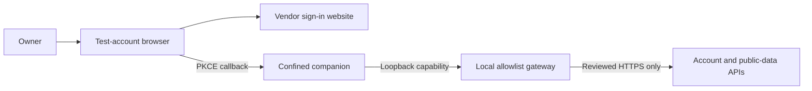

# Controlled manual sign-in and public-data test

## Approved and staged state

Copy08 is **signed, verified and staged; unlaunched** at `/private/tmp/untapped-native-sts2-poc-08/Companion.app`. Its ASAR SHA-256 is `1c343975300061b01917f5258d9f03089c0bb7ed9e21471e9560f055eeb02720`. Only the pinned main/Core/Services entries changed during preparation; all other138 files and symlinks matched the pristine source. The approved outer signature changes only the executable signature and CodeResources seal. Original framework/native binaries, Info.plist and both original entitlement sets remain unchanged; Hardened Runtime is retained. The read-only source image was detached after inspection.

The owner approved the exact local `signing-proposal.json` and `controlled-access-proposal.json` in that private preparation directory, including the first bounded manual sign-in probe. Deep strict signature verification, both architectures' original five entitlements, native payload pins and gateway/adapter hash binding pass. Signed executable SHA-256: `5cc4476cf26ea005a0d4d69021dc9b70a6c7cf939fe9a7e348eb402aed8f3383`.

The signed `companion08.tar` and checksum are staged at `/private/tmp/untapped-sts2-transfer-01`, together with current original helpers and `controlled_sign_in.sh`. Archive SHA-256: `d8b847b8291c6a9f2da72246eabd810c3a52f2e8467681e5ff0c38b0212a85db`. All333 entries were checked for type/mode/content or symlink target; a private exact-mode extraction reproduced the tree and passed signature/payload verification. The archive contains only Companion.app, manifest.json and signing.json, with no profile, Terms, account or logs. Existing copy07 and the approved debug game remain intact. No copy08 application or live request has run yet.

## Boundary and disclosures

The companion still has remote networking denied by its existing outer policy. A local original Python gateway outside that app sandbox can make only reviewed HTTPS requests. It verifies TLS, ignores proxy environment settings, rejects redirects (304 cache responses are allowed), bounds input/output/deadlines and strips credentials on public reads. A random per-run capability protects loopback requests. Prepared metadata freezes the exact gateway/adapter hashes; changed policy/helper code is rejected before activation or staging and requires a new review. Incoming requests are bounded to eight handlers with read deadlines; shutdown stops accepting clients, closes active local sockets and drains tracked handlers before counters are exported. Failure to drain is a failed probe, not a clean result.

The **browser is outside the companion gateway and sandbox**. The owner opens the exact private sign-in URL manually and controls the website's normal traffic, cookies and account consent. No browser opens automatically, no URL protocol or login item is registered, and no system Keychain access is enabled.

The genuine vendor flow requests OAuth scope **`companion:full-access`**. This implementation does not pretend that consent is a narrower vendor token scope: the gateway separately restricts what this companion can send. The vendor receives the ordinary authorization-code/refresh-token exchange, account checks and any allowed public lookup. Passwords/second-factor prompts are handled by the owner in the vendor browser flow; the assistant does not request them.

### Exact companion gateway scope

| Purpose | Method and destination | Body/credential boundary |
| --- | --- | --- |
| OAuth code/refresh | POST `https://api.accounts.untapped.gg/o/token` | Exact authorization-code or refresh fields; original PKCE/state retained; no username/password grant. |
| Global account | GET `https://api.accounts.untapped.gg/api/v1/account` | Bearer account token; no body. |
| STS2 token | POST `https://api.sts2.untapped.gg/api/v1/oauth/tokens/exchange` | Only access_token/client_id, plus bearer token. |
| STS2 account/features | GET `https://api.sts2.untapped.gg/api/v1/account` or `/api/v1/features` | Bearer token, no body. |
| Public game definitions | GET `https://sts2json.untapped.gg/data/public/latest/eng/` plus one of cards.json, relics.json, potions.json, keywords.json, localization/encounters.json, localization/enchantments.json | No credentials/body/query. Initial scope is this exact branch/version/language. |
| Event commentary | GET `https://sts2.untapped.gg/api/v1/commentary/events` | No credentials/body/query. |
| Creator tier list | GET `https://api.sts2.untapped.gg/api/v1/tier-lists/{UUID}/resolve/` | Optional single game_version query; no credentials/body. The selected tier UUID and game version are disclosed by this lookup. |

All other requests fail closed. In particular, stats and prediction POSTs carry offered cards/deck/run context and are **not public reads**; they are blocked along with run history, upload-token/claim endpoints, MTGA APIs, AWS/S3 upload bootstrap/PUT, telemetry, updates and artwork CDNs. Any later expansion needs a concrete new review. Some imagery and statistical panels will therefore remain unavailable in this first phase.

## Genuine sign-in, restricted side effects

The original OAuth PKCE challenge/verifier, state check, loopback callback (localhost/127.0.0.1 ports17791–17799), token exchange and server account verification remain intact. `shell.openExternal` accepts only the reviewed vendor authorization URL shape and writes it to private `manual-sign-in-url.txt` mode0600. It does not invent an account or authentication success.

The original keytar replacement remains in-memory. Controlled mode enumerates only entries for the exact requested credential service, enabling legitimate credentials to be read during the same app lifetime. Ordinary offline mode retains its prior empty-credential behavior. No existing account, Keychain or normal profile is imported.

A narrow controlled-mode guard omits the vendor's unrelated automatic MTGA upload-token bootstrap after successful account verification. Blocking that request alone would otherwise make the vendor remove the newly added account. Anonymous token/claims remain unavailable. STS2 save/log watching, historic upload scheduling, upload entry points and metric initialization/sends are also disabled in this mode; upload functions throw if reached rather than reporting fake success. The gateway independently denies those destinations.

## Credentials, logs and exports

The profile and raw logs remain in the owned0700 private session. Keytar credential values are kept only in process memory, but **vendor logs/settings can contain sensitive account/token material**; this is not a claim that all secrets can never reach private disk. Do not share the manual OAuth URL, raw logs/settings, headers, callback parameters or gateway capability.

The old reward script's raw-log exporter is not used for authenticated runs. `controlled.py` exports only whitelisted harness status/numeric flags, safe event names/timestamps, reward IDs/upgrades/geometry and route/status counters to `sts2test-controlled.*.json`. Raw errors/account fields/URLs/bodies/headers are excluded; CLI error output is generic. Fixed boolean categories identify the existing CloudSaveStore property error or missing public cache without copying the underlying logs. Native/third-party code could still have defects; synthetic tests do not constitute a complete audit.

Every controlled attempt starts a fresh private app profile and memory credential map. Closing the attempt loses that map; the test-account browser can retain its own site cookies under the owner's control. Retained private session folders can be discarded precisely after review; never delete another profile or game save as cleanup.

## Bounded owner-run workflow

1. Completed: apply the exact copy08 outer-only ad-hoc signing proposal, preserving original five entitlements and Hardened Runtime; verify signatures/payloads. No new game signing is needed.
2. Completed: stage only app/manifest/signing receipt as companion08.tar plus checksum, and original harness sources/script. No profile, account settings, Terms, saves or raw logs were transferred.
3. In `sts2test`, close Steam and every game copy, then run `/bin/sh /private/tmp/untapped-sts2-transfer-01/controlled_sign_in.sh` for the approved login-only probe. A later combined reward test uses `--observe-debug-game` with the already verified debug game paused at a reward. This flag verifies that exact game receipt/PID/path/user before attachment.
4. Review Terms manually. Use the companion's sign-in control, read the private URL file in another Terminal, and open that URL yourself in the test-account browser. Do not paste it into this chat. Finish the vendor's sign-in/consent yourself; do not approve unrelated OS prompts.
5. The companion runs at most300 seconds and closes at most45 seconds after the original auth callback reports success, whichever limit comes first. No gameplay is automated. All app descendants and the local gateway are supervised/closed.
6. Send only the sanitized Diagnostic file path. Startup without a real authenticated event is not reported as a successful sign-in; a later nonzero native exit also fails the probe. Do not infer overlay success from authentication alone.

The approved login-only command is ready for the owner to run in UID502. The assistant does not launch it from the original UID501 account. If time expires before sign-in, retain the sanitized result and review it before another attempt.

## Geometry and remaining limits

The recorder now retains scaleX/scaleY alongside GlobalUi-normalized control centers and raw hitbox sizes. `compare-reward` with expected `geometry_space: rendered-hitbox` requires scales and compares width×abs(scaleX) and height×abs(scaleY). Expected card bounds must be independently transcribed from the complete game content viewport, accounting for borders/letterboxing; painted artwork may differ from its hitbox. Legacy raw comparisons are explicitly labeled RAW_ONLY_INCOMPLETE rather than treated as rendered validation.

The prior CloudSaveStore/settings property error can independently leave the vendor overlay's target resolution unavailable. This setup does not patch that compatibility issue or bypass login/feature checks. Live OAuth, account/features population, public-data parsing, overlay rendering/alignment, ratings/advice and broad run tracking are all unverified. The first controlled probe separates these gates and does not promise that sign-in alone will show the overlay.

## Verification so far

All126 portable tests pass, including synthetic JS auth/credential/upload/metric boundaries, original adapter URL validation, gateway default-deny/payload/header/redirect/cache/size/deadline/concurrency tests, supervisor cleanup, sanitized exports and scaled comparisons. Local gateway tests use only fake upstreams. An original inert client under the unchanged outer policy reached the loopback gateway and its fake public response; public credentials were stripped. No vendor service, account or application was contacted/executed in these tests. Copy08's exact three changed JS entries pass Node syntax checks; other138 files and symlinks matched pristine source before signing. Approved signing and verified transfer staging are complete; live integration awaits the owner-run probe.
