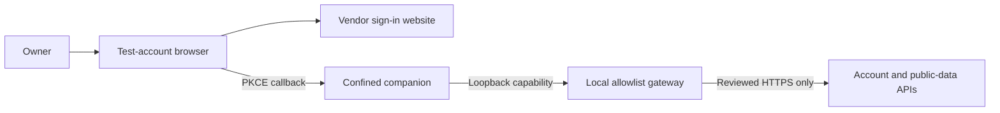

# Controlled manual sign-in and public-data test

## Approved and staged state

**Authenticated native reward reading is verified; the owner saw no overlay.** The combined08c report records genuine sign-in, reader connection,42 reward events, STS2 exchange200, public JSON200×6 and tier resolution200×8, without gateway failures. Headbutt, Forgotten Ritual and Infernal Blade match the photo in order at upgrade0. Native scales are present, but independent rendered geometry remains unverified because the photo crops the game viewport. The settings-property error is still logged.

**Copy09 is signed, verified and staged; its live result is pending.** A fresh pinned source preparation changes exactly five packed JavaScript entries, adding positive local/cloud save-store selection and Darwin access to the normal STS2 settings tab. No global packaged-status, login, feature or badge-mode override is added. The owner must select Badges → Tiers. The vendor's null-settings window/data fallbacks mean the prior settings error alone does not explain absent overlay rendering.

Preparation: `/private/tmp/untapped-native-sts2-poc-09/Companion.app`. ASAR SHA-256: `adf595a36aac17382e928761c0120660b22e2604d75b6dd49ead054f213eddad`. The established approved outer-only ad-hoc reseal retains the original five entitlements on both architectures and Hardened Runtime; no nested code or game is signed. Signed executable SHA-256: `8c094796bf03defd58392f416a6f9abd37cd4b36e153b5c6bad82bdc4fef8145`. Deep strict signature and payload verification pass; source image is detached.

The staged `companion09.tar` SHA-256 is `c07adcadef591266773616252f74fb553436bd053a72021f21d9ac2ddaedf447`. All333 entries and a private exact-mode extraction match type/mode/content/link target and pass signature/payload/policy checks. Only app/manifest/signing receipt are archived; no profile, Terms, account or raw logs. Original helpers, including both new settings dependencies, and launcher have byte parity. Older artifacts remain preserved. No copy09 app or real OAuth has run during preparation.

## Boundary and disclosures

The companion still has remote networking denied by its existing outer policy. A local original Python gateway outside that app sandbox can make only reviewed HTTPS requests. It verifies TLS, ignores proxy environment settings, rejects redirects (304 cache responses are allowed), bounds input/output/deadlines and strips credentials on public reads. A random per-run capability protects loopback requests. Prepared metadata freezes the exact gateway/adapter hashes; changed policy/helper code is rejected before activation or staging and requires a new review. Incoming requests are bounded to eight handlers with read deadlines; shutdown stops accepting clients, closes active local sockets and drains tracked handlers before counters are exported. Failure to drain is a failed probe, not a clean result.

The transport retains the fixed original User-Agent `node-fetch/1.0 (+https://github.com/bitinn/node-fetch)`. Revision08c pins gateway SHA-256 `79c16a7e9cacba58dfaa23b96b0446ddf9496101dd7da00a8e00c675898c85e5`; the CJS adapter is unchanged. Caller-supplied User-Agent remains denied. No destination, method/body permission, credential scope, proxy/redirect/TLS rule or app sandbox rule is expanded. The new proposal discloses the two fixed-data preflight requests and fixed-field failure evidence; old manifests are preserved and their stale hashes refused by current helpers. The launcher now selects companion09 explicitly; the gateway and adapter bytes remain08c. Proposals are labeled proposal_only, separate from recorded runtime evidence.

The **browser is outside the companion gateway and sandbox**. The owner opens the exact private sign-in URL manually and controls the website's normal traffic, cookies and account consent. No browser opens automatically, no URL protocol or login item is registered, and no system Keychain access is enabled.

The genuine vendor flow requests OAuth scope **`companion:full-access`**. This implementation does not pretend that consent is a narrower vendor token scope: the gateway separately restricts what this companion can send. The vendor receives the ordinary authorization-code/refresh-token exchange, account checks and any allowed public lookup. Passwords/second-factor prompts are handled by the owner in the vendor browser flow; the assistant does not request them.

### Exact companion gateway scope

| Purpose | Method and destination | Body/credential boundary |
| --- | --- | --- |
| OAuth code/refresh | POST `https://api.accounts.untapped.gg/o/token` | Exact authorization-code or refresh fields; original PKCE/state retained; no username/password grant. |
| Global account | GET `https://api.accounts.untapped.gg/api/v1/account` | Bearer account token; no body. |
| STS2 token | POST `https://api.sts2.untapped.gg/api/v1/oauth/tokens/exchange` | Only access_token/client_id, plus bearer token. |
| STS2 account/features | GET `https://api.sts2.untapped.gg/api/v1/account` or `/api/v1/features` | Bearer token, no body. |
| Public game definitions | GET `https://sts2json.untapped.gg/data/public/latest/eng/` plus one of cards.json, relics.json, potions.json, keywords.json, localization/encounters.json, localization/enchantments.json | No credentials/body/query. Initial scope is this exact branch/version/language. |
| Event commentary | GET `https://sts2.untapped.gg/api/v1/commentary/events` | No credentials/body/query. |
| Creator tier list | GET `https://api.sts2.untapped.gg/api/v1/tier-lists/{UUID}/resolve/` | Optional single game_version query; no credentials/body. The selected tier UUID and game version are disclosed by this lookup. |

All other requests fail closed. In particular, stats and prediction POSTs carry offered cards/deck/run context and are **not public reads**; they are blocked along with run history, upload-token/claim endpoints, MTGA APIs, AWS/S3 upload bootstrap/PUT, telemetry, updates and artwork CDNs. Any later expansion needs a concrete new review. Some imagery and statistical panels will therefore remain unavailable in this first phase.

## Genuine sign-in, restricted side effects

The original OAuth PKCE challenge/verifier, state check, loopback callback (localhost/127.0.0.1 ports17791–17799), token exchange and server account verification remain intact. `shell.openExternal` accepts only the reviewed vendor authorization URL shape and writes it to private `manual-sign-in-url.txt` mode0600. It does not invent an account or authentication success.

The original keytar replacement remains in-memory. Controlled mode enumerates only entries for the exact requested credential service, enabling legitimate credentials to be read during the same app lifetime. Ordinary offline mode retains its prior empty-credential behavior. No existing account, Keychain or normal profile is imported.

A narrow controlled-mode guard omits the vendor's unrelated automatic MTGA upload-token bootstrap after successful account verification. Blocking that request alone would otherwise make the vendor remove the newly added account. Anonymous token/claims remain unavailable. STS2 save/log watching, historic upload scheduling, upload entry points and metric initialization/sends are also disabled in this mode; upload functions throw if reached rather than reporting fake success. The gateway independently denies those destinations.

## Credentials, logs and exports

The profile and raw logs remain in the owned0700 private session. Keytar credential values are kept only in process memory, but **vendor logs/settings can contain sensitive account/token material**; this is not a claim that all secrets can never reach private disk. Do not share the manual OAuth URL, raw logs/settings, headers, callback parameters or gateway capability.

The old reward script's raw-log exporter is not used for authenticated runs. `controlled.py` exports only whitelisted harness status/numeric flags, safe event names/timestamps, reward IDs/upgrades/geometry and route/status counters to `sts2test-controlled.*.json`. Raw errors/account fields/URLs/bodies/headers are excluded; CLI error output is generic. Fixed boolean categories identify the existing CloudSaveStore property error or missing public cache without copying the underlying logs. Native/third-party code could still have defects; synthetic tests do not constitute a complete audit.

Every controlled attempt starts a fresh private app profile and memory credential map. Closing the attempt loses that map; the test-account browser can retain its own site cookies under the owner's control. Retained private session folders can be discarded precisely after review; never delete another profile or game save as cleanup.

## Bounded owner-run workflow

1. Completed: prepare and apply copy09's established outer-only ad-hoc signing procedure, preserving the original five entitlements and Hardened Runtime; verify signatures/payloads. No new game signing is needed.
2. Completed: stage only app/manifest/signing receipt as companion09.tar plus checksum, and original harness sources/script. No profile, account settings, Terms, saves or raw logs were transferred.
3. Review copy09's settings/UI scope and unchanged08c preflight/data scope below. In `sts2test`, close Steam and every game copy, then run `/bin/sh /private/tmp/untapped-sts2-transfer-01/controlled_sign_in.sh` to initiate it. Signed-copy validation happens before network access. Two fixed-data requests pass through the same capability gateway; the companion opens only after both expected401 JSON objects pass. A failure exports a diagnostic and opens no app. A later `--observe-debug-game` mode still verifies the exact debug-game receipt/PID/path/user.
4. Review Terms manually. Use the companion's sign-in control; Terminal now prints a complete cat command containing only the new private URL-file path. Run it in another Terminal and open the resulting URL yourself in the test-account browser. Do not reuse an old URL or paste it into this chat. Finish the vendor's sign-in/consent yourself; do not approve unrelated OS prompts.
5. Signed validation/preflight time counts against the existing300-second app-attempt budget; the app receives only the remaining whole seconds. It closes at most45 seconds after genuine auth, or earlier at the remaining deadline. Cleanup still drains the gateway afterward. No gameplay is automated; descendants/gateway remain supervised.
6. Send only the sanitized Diagnostic file path. Startup without a real authenticated event is not reported as a successful sign-in; a later nonzero native exit also fails the probe. Do not infer overlay success from authentication alone.

The original login and08b retry failed;08c subsequently completed real sign-in in UID502. The assistant has not started a real sign-in or companion from UID501. The next owner action uses copy09 with the existing isolated debug game and selects the normal Tiers badge control, as described in the runbook.

## First live sign-in result and read-only follow-up

The sanitized `sts2test-controlled.7a7o1dnx.json` records bootstrap/ready/manual-sign-in-ready, Core initialization, no startup blockers, companion exit0 and complete gateway cleanup. One request reached route oauth_token and received HTTP403; no local denied-route count or authenticated event followed. The vendor browser and companion displayed authentication failure. These counters distinguish an upstream HTTP rejection from this gateway's allowlist rejection, but do not identify the upstream reason. No account or public-data request is recorded; the login-only settings/cache flags do not establish game compatibility.

The original `harness.auth_diagnostic` command reads only the last2MiB of stdout.log and profile/log.log in an owned0700 controlled attempt. It refuses redirected, linked, nonregular or other-owner inputs, verifies the controlled launch metadata, and examines bounded token-grant error bodies. The shared `sts2test-auth-error.*.json` contains only fixed HTML/browser-challenge/provider markers, known OAuth error codes, original completion/failure booleans and input-limit counters. No response text, URL, header, account value or unknown error code is copied. This is a read-only saved-data check: no app launch, sign-in or network request, and no signed payload/policy change. A security-page marker is evidence of page content, not proof of the rejection's cause.

The owner ran the classifier. `sts2test-auth-error.sab2rzl0.json` reports UNCLASSIFIED_TOKEN_ERROR, a logged token failure and callback failure, no completed token exchange and no HTML/challenge/provider/known OAuth markers; both bounded input logs were read without truncation. This does not identify the body or rejection reason, and no raw text was shared.

Two subsequent credential-free GETs to the same already reviewed account endpoint changed only User-Agent: Python's default received403 text/plain (17 bytes), while the pinned original companion value received401 application/json (85 bytes) with the standard missing-credentials message. They used normal TLS, no redirects and no account/token/cookie/body/query. This proves a header-dependent rejection on that endpoint, not a successful OAuth exchange or the internal reason for the upstream rule. An inert on-wire regression reproduces403 before the correction and401 afterward. The next useful step is the reviewed owner-run retry, not another saved-log export.

## Revision08b result and fixed-data transport check

The owner-run08b export `sts2test-controlled.w7jrcoj3.json` contains ready/Core initialization, no startup blockers, clean exit0 and gateway cleanup, no authenticated event and only route error502 once. This is the gateway's generic exception branch, not a recorded upstream HTTP status. It does not identify whether the exception was DNS, TLS, timeout, response handling or something else.

One negative-test POST from UID501 to the reviewed token route, using only fixed nonexistent client/code/verifier data, returned the normal401 JSON invalid_client. The launcher's exact Python interpreter is3.11.2 with readable default CA file and no CA environment overrides in UID501. A separate inert local HTTP/TLS response matrix found no exception for200 keepalive, connection close, chunked or401 responses. These finite checks do not reproduce UID502's exception.

The original `harness.transport_diagnostic` checker must run in sts2test with the same interpreter as the launcher. It makes at most two existing reviewed requests: a GET account without credentials, followed by a token POST containing only fixed nonexistent client/code/verifier values. It stops before the second request if the first transport raises. Both use existing HTTPS/TLS/proxy/redirect and I/O restrictions; no app, browser, account, saved OAuth request or private log is opened. Its shared `sts2test-transport.*.json` contains only fixed response/error categories, statuses/byte counts, numeric Python version, CA accessibility/override booleans and bounded numeric error codes. It excludes raw exception messages, response text/headers, CA paths, environment values and account details. This is a diagnostic request sequence, not a real sign-in attempt or authentication result.

The owner completed that check: `sts2test-transport.lawr_85r.json` records401 JSON for both requests,85/27 bytes, the same Python3.11.2 and readable default CA file without overrides. The fixed inputs did not reproduce the exception. A separate UID501 full capability-gateway comparison also returned both401 responses with no failures and clean drain. These checks do not identify the real-flow exception or prove successful token handling.

## Revision08c preflight and safe failure evidence

The preflight sends the same two fixed-data requests through the actual listening gateway, with its per-run capability. It requires both401 bodies to parse as bounded UTF-8 JSON objects, rejecting malformed/empty/scalar/nonfinite/duplicate-key bodies. At most32768 response bytes are held privately in memory; only status/kind/byte count/json_object booleans are exported. The local sequence has a15-second deadline and stops at its first unexpected result or exception. Signed metadata/signature validation and game/Steam guards precede it. A failed check or exhausted attempt budget starts no companion.

The gateway records at most32 generic failure entries: fixed route, fixed stage (local request, upstream transport, upstream response or local response), bounded elapsed milliseconds, safe error category and optional bounded errno/certificate verification code. There are no messages, URLs, tokens, headers, bodies or arbitrary exception class names. Overflow is counted. The standalone checker reuses the same classifier. Shared output labels preflight/app counters separately and marks every failure's phase. When no app opens, all final post-drain counts/failures remain preflight, including late cleanup failures. Export still requires a complete gateway drain.

The owner-run output adds preflight, preflight_gateway_counts, gateway_failures and gateway_failure_overflow. Preflight success never substitutes for the genuine authenticated event and healthy native exit. The source review corrected JSON validation and late-error attribution; tests cover both plus closed-response portability. A real08c preflight in UID501 passed both fixed requests with no failures and clean drain, using no account/app. This is a diagnostic improvement, not a claimed fix for the real login exception. Follow the [runbook](Test-Account-Runbook.md) for the next manual attempt and send only its Diagnostic file path.

## Geometry and remaining limits

The recorder now retains scaleX/scaleY alongside GlobalUi-normalized control centers and raw hitbox sizes. `compare-reward` with expected `geometry_space: rendered-hitbox` requires scales and compares width×abs(scaleX) and height×abs(scaleY). Expected card bounds must be independently transcribed from the complete game content viewport, accounting for borders/letterboxing; painted artwork may differ from its hitbox. Legacy raw comparisons are explicitly labeled RAW_ONLY_INCOMPLETE rather than treated as rendered validation.

Copy09 supports exact native GodotFileIo and CloudSaveStore variants while preserving the original settings schema and errors for unknown types. The offline game launcher leaves Steam uninitialized; pinned metadata/IL shows this retains a direct GodotFileIo, so the vendor's unconditional LocalStore request is incompatible. Recovery remains a real-runtime check. There are already window-placement and public-data fallbacks without settings, so this error is not a proven cause of the invisible overlay.

The vendor defaults to stats badges. This policy blocks stats/predictions because they send gameplay context. Copy09 exposes the existing STS2 settings tab on packaged Darwin; it does not choose a mode or author. Select Slay The Spire 2 → Badges → Tiers through the normal account gate. Public/latest/eng definitions and tier-resolution permissions are unchanged; version-specific reads may fail and use the vendor's existing latest fallback. No fabricated settings, scores or feature state are supplied.

Fixed events settings-read, overlay-ready and overlay-show contain only name/time. Sanitized settings_reading and overlay_window describe those calls; overlay remains UNTESTED_REQUIRES_VISUAL_CHECK. Window-show calls cannot establish rendered card badges or alignment.

## Verification so far

All164 tests pass, covering local/cloud native variants, unknown types/native errors, exact five-entry patch guards, packaged-Darwin settings access and lifecycle/privacy separation, plus existing gateway/supervisor checks. Tests use original synthetic fixtures and fake/local servers. Read-only review found no concrete issue. Native/source/archive/extraction/source-parity checks also pass. Copy09 settings recovery, visible Tiers badges and independent geometry await the owner-run observation.

## Verified08c login-only result and next reward check

The owner reported successful sign-in, confirmed by /private/tmp/sts2test-controlled.mjy01eeq.json: preflight passed, bootstrap/ready/Core initialization, genuine authenticated event at21:26:36.436Z on2026-11-03, one oauth_token200 and one accounts_account200. There are no gateway failures or overflow. The post-auth limit was reached with complete gateway cleanup and no recorded failing native exit. Preflight401s are separate from the real200s; no raw logs/account details were exported. The older502's exact cause remains unknown, so success is not attributed to a speculative fix.

No game was present. This report does not establish STS2 token/features or public definitions, native game attachment under authentication, game-settings compatibility, overlay/rating display or scaled geometry. Start the already approved900-second debug-game session in sts2test, pause at a card reward, then use controlled_sign_in.sh --observe-debug-game. Fresh profiles and memory-only keytar require manual sign-in again for that combined attempt; test-account browser cookies may remain. Keep stats/uploads/telemetry/artwork restrictions and send only the sanitized combined Diagnostic file.

## Authenticated08c reward observation and copy09 follow-up

Sanitized sts2test-controlled.rbnc3vt6.json records reader-connected before genuine authentication and42 reward events including after authentication. The first/last reward IDs agree on HEADBUTT0, FORGOTTEN_RITUAL0 and INFERNAL_BLADE0. Account/token and STS2 exchange returned200, six public definitions and eight tier resolutions returned200; one unknown denied route403 is retained without inferring its identity. There are no gateway exceptions/overflow and cleanup is complete. The owner explicitly reported no overlay. Settings read failure is recorded; public cache missing is false. This proves successful data requests, not every renderer/feature gate.

Use the current owner-run sequence in the runbook; fresh profiles still require manual Terms/sign-in and Tiers selection. No broader network permission or automated UI action is part of copy09.

## Bounded tier-list startup queue

The companion adapter now shares a FIFO queue across its fetch wrappers, allowing four active requests and at most128 waiting requests with a60-second queue wait limit. Slots remain occupied until the bounded response body finishes; the adapter returns a normal vendor `Response` with status, headers and URL preserved. This prevents the12 default tier resolutions plus public-definition startup burst from exceeding the unchanged gateway's eight-handler ceiling. Requests larger than the gateway's32KiB input limit are rejected before queueing; responses retain the8MiB limit and15-second fetch/body timeout.

Only an exact public tier-resolve GET, with no body and the already reviewed optional `game_version`, receives retries: at most three attempts with250ms then750ms backoff. Connection reset/refused/timeout/broken-pipe and fetch request/body timeouts, or HTTP502/503/504, qualify. Queue overflow/expiry, permanent HTTP errors (including401/403/404), token exchanges and all other routes are not retried. Backoff releases the active slot. Exhaustion remains a real failure; no tier data or success is fabricated.

Gateway code, destinations, methods, credential stripping, TLS/redirect/proxy restrictions and outer sandbox remain unchanged. Existing manifests still reject mismatched helper bytes. The main-account installation records the reviewed adapter-only change in a private `tier-queue-update.json`, retaining both original manifests and old/new hashes before replacing only their `controlled_network_sha256` field. Original approval/signing records and signed app payloads remain intact. An interrupted migration fails closed until both manifests are reconciled with that receipt; old isolated copies require their own explicit reviewed refresh before using the new helper.
