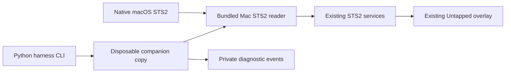

# Harness architecture

This proof of concept keeps the native macOS game and Untapped's existing reader/service/overlay path. It adds a small **original-code** preparation and diagnostic layer; it does not implement a substitute advisor.

## Version and copy boundary

`harness.cli inspect` checks the user-supplied Mac companion version `3.12.3-latest`, whole `app.asar` SHA-256 `ca3a2e6a6f728b2d635abfc70a5434d4107438b8d801a650357989e8442d798c`, specific native reader/Electron binary hashes, both fuse wires, required archive entries, and exact patch anchors. The source signature is checked before preparation on macOS. These pins prevent silently applying the patches to a different release.

`prepare` creates a new session outside the repository, copies the app, and rewrites two packed JavaScript entries in that copy: the main entry and STS2 Core chunk. The original app and game are not modified. The ASAR file table offsets and per-entry integrity records are recalculated. The copy retains the vendor `Info.plist` header hash unchanged; this inspected binary has embedded ASAR validation and ASAR-only-loading fuses disabled (`10110001` in each slice). Rewriting the sealed ASAR **invalidates the copied bundle's vendor signature**. The harness does not re-sign or edit entitlements; whether signature enforcement prevents launch remains unverified. [Electron's ASAR integrity documentation](https://www.electronjs.org/docs/latest/tutorial/asar-integrity) and [fuse documentation](https://www.electronjs.org/docs/latest/tutorial/fuses) explain those mechanisms.

The patch enables Darwin only in STS2's constructor and enable check. It does not change `app.isPackaged` globally. It suppresses other game initialization, automatic login-item setup, URL-handler registration, and Sentry startup reporting in the copy. It adds bounded events for window detection, reader connection, and reward items. Untapped's own bundled native reader, services, and overlay remain the data path; their runtime behavior has not yet been established.

## Offline startup boundary

`launch` uses a fresh, single-use session for up to 60 seconds through macOS `sandbox-exec`. Its policy denies reads from the real home, writes outside the session, and remote network connections while allowing loopback. It also denies the `securityd` lookup. Smoke probes on October 30, 2026 confirmed denied home reads, outside writes, and remote IP sockets, with allowed session writes and loopback. These probes validate the policy's basic behavior, not every possible native side effect. The launcher terminates its own process group after the time limit, including descendants left behind if the leader exits.

The injected bootstrap redirects Electron home, user data, app data, session data, logs, crash dumps, and temp paths into the session. It intercepts `keytar` with a memory-only credential store and blocks external-link opening, login-item changes, and protocol registration. The launch environment activates the vendor's `UC_TEST_SANDBOX_DIR`, `UC_TEST_SANDBOX_ID`, and `UC_SKIP_UPDATE_CHECKS` hooks and excludes inherited credentials and overrides. Terms are neither preaccepted nor bypassed. Network-dependent statistics, login, uploads, and advice cannot be tested while the offline policy is in force. An enabled STS2 UI alone would not prove those functions work.

The CLI never launches the game, links real saves, or changes the installed game signature. A copied game would still potentially share its save location and Steam Cloud state; a game-profile and cloud strategy must be settled before a live reward experiment. Apple's [debugger entitlement reference](https://developer.apple.com/documentation/bundleresources/entitlements/com.apple.security.cs.debugger) is relevant to a possible attachment hurdle, but no attachment result yet identifies signing as the cause.

## Private outputs and rollback

Each session contains `Companion.app`, `manifest.json`, the offline sandbox policy, a private profile, and optional launch stdout/log/event files. No session or vendor binary belongs in Git. The launcher stops only its own bounded process group. To roll back, let the probe end, then discard **only that session directory** using Finder or an equivalently precise file operation. There is no system-wide installation or game/save modification to undo.
