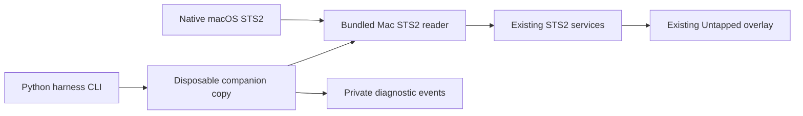

# Harness architecture

This proof of concept keeps the native macOS game and Untapped's existing reader/service/overlay path. It adds a small **original-code** preparation and diagnostic layer; it does not implement a substitute advisor.

## Version and copy boundary

`harness.cli inspect` checks the user-supplied Mac companion version `3.12.3-latest`, whole `app.asar` SHA-256 `ca3a2e6a6f728b2d635abfc70a5434d4107438b8d801a650357989e8442d798c`, specific native reader/Electron binary hashes, both fuse wires, required archive entries, and exact patch anchors. The source signature is checked before preparation on macOS. These pins prevent silently applying the patches to a different release.

`prepare` creates a new session outside the repository, copies the app, and rewrites three packed JavaScript entries in that copy: the main entry, STS2 Core chunk, and Services chunk. The original app and game are not modified. The ASAR file table offsets and per-entry integrity records are recalculated. The copy retains the vendor `Info.plist` header hash unchanged; this inspected binary has embedded ASAR validation and ASAR-only-loading fuses disabled (`10110001` in each slice). Rewriting the sealed ASAR **invalidates the copied bundle's vendor signature**. Preparation does not re-sign or edit entitlements. Gatekeeper rejection of that invalid sealed resource has now been observed before JavaScript startup. [Electron's ASAR integrity documentation](https://www.electronjs.org/docs/latest/tutorial/asar-integrity) and [fuse documentation](https://www.electronjs.org/docs/latest/tutorial/fuses) explain those mechanisms.

The patch enables Darwin only in STS2's constructor and enable check. It does not change `app.isPackaged` globally. It suppresses other game initialization, automatic login-item setup, URL-handler registration, and Sentry startup reporting in the copy. It adds bounded events for window detection, reader connection, and reward items. Untapped's own bundled native reader, services, and overlay remain the data path; their runtime behavior has not yet been established.

Initial unlocked diagnostics identified Gatekeeper rejection of the invalid resource seal before JavaScript. `signing-proposal` prepares a plist and prints an exact per-copy command without signing. The opt-in `sign-copy` command requires owner approval and its explicit CLI flag; it re-signs only the outer companion, offline, preserving the five original entitlements and Hardened Runtime. It verifies nested code rather than re-signing it, then records a session-bound executable hash in `signing.json`. Launch recognizes that specific hash, rechecks the signed bundle, and retains all other binary/archive pins. The owner approved and executed this operation on one disposable copy: its outer seal and both original entitlement sets verified, and it now reaches Electron readiness. Ad-hoc identity carries no Untapped Developer ID or notarization trust, so it does not guarantee startup or authorize an OS exception.

## Offline startup boundary

`launch` uses a fresh, single-use session for up to 60 seconds through macOS `sandbox-exec`. Its policy denies reads from the real home, writes outside the session, and remote network connections while allowing loopback. It also denies the `securityd` lookup. Smoke probes on October 30, 2026 confirmed denied home reads, outside writes, and remote IP sockets, with allowed session writes and loopback. These probes validate the policy's basic behavior, not every possible native side effect. The launcher terminates its own process group after the time limit, including descendants left behind if the leader exits.

The injected bootstrap redirects Electron home, user data, app data, session data, logs, crash dumps, and temp paths into the session. It intercepts `keytar` with a memory-only credential store and blocks external-link opening, login-item changes, and protocol registration. The launch environment activates the vendor's `UC_TEST_SANDBOX_DIR`, `UC_TEST_SANDBOX_ID`, and `UC_SKIP_UPDATE_CHECKS` hooks and excludes inherited credentials and overrides. `MAC_CHROMIUM_TMPDIR` points to the short session-local `t/` directory because Chromium does not directly use `TMPDIR` for this path. Terms are neither preaccepted nor bypassed. Network-dependent statistics, login, uploads, and advice cannot be tested while the offline policy is in force. An enabled STS2 UI alone would not prove those functions work.

The Services patch makes `ensureLocalCredentials()` immediately return an empty authenticated-credential map and null anonymous credentials only when `UNTAPPED_HARNESS_OFFLINE=1`. It avoids account credential reads and anonymous-token acquisition without fabricating a login, token, or account feature. Other vendor network paths remain subject to the outer deny policy. The ordinary credential path remains intact outside that exact environment value, though the harness bootstrap requires offline mode. A protected copy05 launch now records manual Terms acceptance followed by Fully initialized, with no anonymous-token acquisition/retry lines. This establishes the offline startup adaptation, not game reading or account features.

The CLI never launches the game, links real saves, or changes the installed game signature. A copied game would still potentially share its save location and Steam Cloud state; a game-profile and cloud strategy must be settled before a live reward experiment. Apple's [debugger entitlement reference](https://developer.apple.com/documentation/bundleresources/entitlements/com.apple.security.cs.debugger) is relevant to a possible attachment hurdle, but no attachment result yet identifies signing as the cause.

## Private outputs and rollback

Each session contains `Companion.app`, `manifest.json`, the offline sandbox policy, a private profile, and optional launch stdout/log/event files. No session or vendor binary belongs in Git. The launcher stops only its own bounded process group. To roll back, let the probe end, then discard **only that session directory** using Finder or an equivalently precise file operation. There is no system-wide installation or game/save modification to undo.

## Observed child sandbox blocker

The signed copy reaches Electron readiness, but its instance socket setup fails and its child helpers cannot initialize their own Seatbelt policy after inheriting the outer policy. The vendor's existing-instance warning also covers lock errors; it does not establish another running companion. Status exposes these blockers separately from Electron readiness and records Core/terms log milestones without claiming visible UI. The owner-approved single-layer experiment subsequently started Core and logged the Terms screen.

A session-local Unix-socket allowance was tested only with synthetic sockets: inside-session bind succeeded, outside-session connect and remote-IP connect were denied, real-home read/outside write were denied. The default launcher policy has not been relaxed. The owner then approved and executed one 45-second `--no-sandbox` launch on this copy while retaining the outer network/home/write restrictions and session-path Unix IPC. It started Core and logged Terms. Chromium child sandbox restrictions are removed in this mode, while separate OS processes remain. The opt-in `launch-outer` command makes that experiment repeatable with a fresh attempt profile, signed-copy checks, and process-group cleanup. See [the scope and results](Verification.md#approved-single-layer-experiment).

## Observation boundary

A CUA app-selection call during the bounded experiment timed out after the runner ended. A later process check found a new exact-copy instance with helper arguments pointing at the normal companion profile. That extra instance was stopped; its launch source is inferred from timing, not proven. Native profile/cache effects are unknown, and the normal profile was neither read nor deleted to speculate about them. The JavaScript guard precedes vendor imports but cannot protect native initialization that runs earlier. Only the CLI supervisor should launch the copy; observation must not launch or reopen it.

On November 2, the first accepted copy04 attempt recorded the owner's manual Terms action in its own private profile. Post-Terms startup retried anonymous-token requests blocked by the offline policy; Core did not log full initialization before timeout. The process group was cleaned up and no exact-copy process remained. This established the manual Terms milestone before the offline initialization adaptation below.

The owner then separately approved signing and protected startup for copy05 with the offline credential guard. Outer-only signing and verification passed. Its first two fresh private attempts logged Terms without recording acceptance before their timeouts. After the owner clarified that Accept had not been clicked, another approved 45-second window recorded manual acceptance and Fully initialized. The process group was cleaned up and no copy05 process remained. Reusing this signed copy under the already approved protected mode requires no further signing; manual interaction remains necessary because each attempt starts with fresh settings.

## Planned game isolation

The owner selected an isolated-profile plan before any game launch. The [plan](Isolated-Game-Plan.md) recommends a separate standard macOS account for both game and companion in one graphical session. The installed game's no-Steam and no-mods flags are statically verified; their runtime behavior and the proposed confinement are untested. No account has been created, game copy prepared, Steam setting changed, or game launch attempted.

For the first reward milestone the companion can keep save/history lookup empty. Reward IDs, upgrade levels, and geometry come from live game objects. Its watcher derives save paths under its own redirected home and would not automatically follow the test game's separate data root. Run/history tracking and Steam identity remain unverified. The native window matcher receives the owner name without a path restriction, so a future launcher must independently confirm a single expected PID, executable path, and user before attachment; a detected window alone does not identify a particular copy. Cross-user attachment is not established.

## Isolated first-boot launcher and target identity

`harness.game_launch` prepares a hash/signature-verified unchanged game copy and runs a bounded first boot only in the declared separate standard account. Its policy confines writes to that account/session and denies normal-home access and networking. It monitors conflicting Steam/game processes and records observed target identity, but leaves isolation verification false pending private boot-log/data review. Transfer staging and the manual account script contain no normal save/profile data.

New companion preparations check the expected PID, executable and user before STS2 reader construction. `launch-outer` verifies these before spawning, and the bootstrap checks them again at attachment using a bounded original libproc helper. Targeted launches compile `target_identity.c` with the installed `/usr/bin/clang` into the fresh owned 0700 profile before app startup. The bootstrap requires a regular owned 0700 helper with one hard link and the expected SHA-256 before invoking it with only the PID. The helper refuses elevated/different-user targets and checks PID/start metadata before and after reading the full executable path. Startup-only launches require no compiler. Compilation failure prevents app launch. A missing target refuses attachment; startup-only runs remain usable. A race remains between identity inspection and native connection. Copy06 detected a window but its guard could not execute setuid `/bin/ps` under the outer policy. Copy07 replaces that command without relaxing the policy; its signing/launch remain pending. Existing signed copy05 retains its earlier behavior.

The game launch environment restores HOME from the validated test account's real OS home, rather than inheriting caller environment or using a relative fallback. This corrects the earlier stripped-HOME configuration without enlarging the write policy (which already permits that disposable account home). Old relative data remains preserved; actual paths and native stability need the controlled test-account comparison.

For the helper-discovery diagnostic, the reader wrapper accepts an additional constrained private-tmp namespace: canonical `/private/tmp/uc-sts2-UID-*`, owned by the current verified test user with exact mode 0700. Startup-only refuses all Steam/game processes and supplies no target, preserving the pre-construction guard. The signed app bytes and outer policy are unchanged; layout-specific vendor startup remains unverified.
