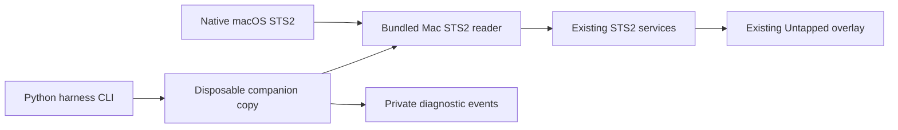

# Harness architecture

This proof of concept keeps the native macOS game and Untapped's existing reader/service/overlay path. It adds a small **original-code** preparation and diagnostic layer; it does not implement a substitute advisor.

## Version and copy boundary

`harness.cli inspect` checks the user-supplied Mac companion version `3.12.3-latest`, whole `app.asar` SHA-256 `ca3a2e6a6f728b2d635abfc70a5434d4107438b8d801a650357989e8442d798c`, specific native reader/Electron binary hashes, both fuse wires, required archive entries, and exact patch anchors. The source signature is checked before preparation on macOS. These pins prevent silently applying the patches to a different release.

`prepare` creates a new session outside the repository, copies the app, and rewrites five packed JavaScript entries in that copy: the main entry, STS2 Core chunk, Services chunk, ScryRuntime chunk, and main settings UI asset. The original app and game are not modified. The ASAR file table offsets and per-entry integrity records are recalculated. The copy retains the vendor `Info.plist` header hash unchanged; this inspected binary has embedded ASAR validation and ASAR-only-loading fuses disabled (`10110001` in each slice). Rewriting the sealed ASAR **invalidates the copied bundle's vendor signature**. Preparation does not re-sign or edit entitlements. Gatekeeper rejection of that invalid sealed resource has now been observed before JavaScript startup. [Electron's ASAR integrity documentation](https://www.electronjs.org/docs/latest/tutorial/asar-integrity) and [fuse documentation](https://www.electronjs.org/docs/latest/tutorial/fuses) explain those mechanisms.

The patch enables Darwin only in STS2's constructor, enable check, and settings menu entry. It does not change `app.isPackaged` globally or remove the menu's normal login and feature checks. It suppresses other game initialization, automatic login-item setup, URL-handler registration, and Sentry startup reporting in the copy. It adds bounded events for window detection, reader connection, reward items, valid settings reads, and overlay renderer ready/show calls. Untapped's own bundled native reader, services, and overlay remain the data path. A ready/show event is a lifecycle marker, not visual proof.

Initial unlocked diagnostics identified Gatekeeper rejection of the invalid resource seal before JavaScript. `signing-proposal` prepares a plist and prints an exact per-copy command without signing. The opt-in `sign-copy` command requires owner approval and its explicit CLI flag; it re-signs only the outer companion, offline, preserving the five original entitlements and Hardened Runtime. It verifies nested code rather than re-signing it, then records a session-bound executable hash in `signing.json`. Launch recognizes that specific hash, rechecks the signed bundle, and retains all other binary/archive pins. The owner approved and executed this operation on one disposable copy: its outer seal and both original entitlement sets verified, and it now reaches Electron readiness. Ad-hoc identity carries no Untapped Developer ID or notarization trust, so it does not guarantee startup or authorize an OS exception.

## Offline startup boundary

`launch` uses a fresh, single-use session for up to 60 seconds through macOS `sandbox-exec`. Its policy denies reads from the real home, writes outside the session, and remote network connections while allowing loopback. It also denies the `securityd` lookup. Smoke probes on October 30, 2026 confirmed denied home reads, outside writes, and remote IP sockets, with allowed session writes and loopback. These probes validate the policy's basic behavior, not every possible native side effect. The launcher terminates its own process group after the time limit, including descendants left behind if the leader exits.

The injected bootstrap redirects Electron home, user data, app data, session data, logs, crash dumps, and temp paths into the session. It intercepts `keytar` with a memory-only credential store and blocks external-link opening, login-item changes, and protocol registration. The launch environment activates the vendor's `UC_TEST_SANDBOX_DIR`, `UC_TEST_SANDBOX_ID`, and `UC_SKIP_UPDATE_CHECKS` hooks and excludes inherited credentials and overrides. `MAC_CHROMIUM_TMPDIR` points to the short session-local `t/` directory because Chromium does not directly use `TMPDIR` for this path. Terms are neither preaccepted nor bypassed. Network-dependent statistics, login, uploads, and advice cannot be tested while the offline policy is in force. An enabled STS2 UI alone would not prove those functions work.

The Services patch makes `ensureLocalCredentials()` immediately return an empty authenticated-credential map and null anonymous credentials only when `UNTAPPED_HARNESS_OFFLINE=1`. It avoids account credential reads and anonymous-token acquisition without fabricating a login, token, or account feature. Other vendor network paths remain subject to the outer deny policy. The ordinary credential path remains intact outside that exact environment value, though the harness bootstrap requires offline mode. A protected copy05 launch now records manual Terms acceptance followed by Fully initialized, with no anonymous-token acquisition/retry lines. This establishes the offline startup adaptation, not game reading or account features.

The CLI never launches the game, links real saves, or changes the installed game signature. A copied game would still potentially share its save location and Steam Cloud state; a game-profile and cloud strategy must be settled before a live reward experiment. Apple's [debugger entitlement reference](https://developer.apple.com/documentation/bundleresources/entitlements/com.apple.security.cs.debugger) is relevant to a possible attachment hurdle, but no attachment result yet identifies signing as the cause.

## Private outputs and rollback

Each session contains `Companion.app`, `manifest.json`, the offline sandbox policy, a private profile, and optional launch stdout/log/event files. No session or vendor binary belongs in Git. The launcher stops only its own bounded process group. To roll back, let the probe end, then discard **only that session directory** using Finder or an equivalently precise file operation. There is no system-wide installation or game/save modification to undo.

## Observed child sandbox blocker

The signed copy reaches Electron readiness, but its instance socket setup fails and its child helpers cannot initialize their own Seatbelt policy after inheriting the outer policy. The vendor's existing-instance warning also covers lock errors; it does not establish another running companion. Status exposes these blockers separately from Electron readiness and records Core/terms log milestones without claiming visible UI. The owner-approved single-layer experiment subsequently started Core and logged the Terms screen.

A session-local Unix-socket allowance was tested only with synthetic sockets: inside-session bind succeeded, outside-session connect and remote-IP connect were denied, real-home read/outside write were denied. The default launcher policy has not been relaxed. The owner then approved and executed one 45-second `--no-sandbox` launch on this copy while retaining the outer network/home/write restrictions and session-path Unix IPC. It started Core and logged Terms. Chromium child sandbox restrictions are removed in this mode, while separate OS processes remain. The opt-in `launch-outer` command makes that experiment repeatable with a fresh attempt profile, signed-copy checks, and process-group cleanup. See [the scope and results](Verification.md#approved-single-layer-experiment).

## Observation boundary

A CUA app-selection call during the bounded experiment timed out after the runner ended. A later process check found a new exact-copy instance with helper arguments pointing at the normal companion profile. That extra instance was stopped; its launch source is inferred from timing, not proven. Native profile/cache effects are unknown, and the normal profile was neither read nor deleted to speculate about them. The JavaScript guard precedes vendor imports but cannot protect native initialization that runs earlier. Only the CLI supervisor should launch the copy; observation must not launch or reopen it.

On November 2, the first accepted copy04 attempt recorded the owner's manual Terms action in its own private profile. Post-Terms startup retried anonymous-token requests blocked by the offline policy; Core did not log full initialization before timeout. The process group was cleaned up and no exact-copy process remained. This established the manual Terms milestone before the offline initialization adaptation below.

The owner then separately approved signing and protected startup for copy05 with the offline credential guard. Outer-only signing and verification passed. Its first two fresh private attempts logged Terms without recording acceptance before their timeouts. After the owner clarified that Accept had not been clicked, another approved 45-second window recorded manual acceptance and Fully initialized. The process group was cleaned up and no copy05 process remained. Reusing this signed copy under the already approved protected mode requires no further signing; manual interaction remains necessary because each attempt starts with fresh settings.

## Planned game isolation

The owner selected an isolated-profile plan before any game launch. The [plan](Isolated-Game-Plan.md) recommends a separate standard macOS account for both game and companion in one graphical session. The `sts2test` account and approved debug game copy now implement that separation; the owner reached native reward screens and the reader connected. This establishes the observed test path, while broader save/Steam isolation and long-run stability are not certified by these bounded checks.

For the first reward milestone the companion can keep save/history lookup empty. Reward IDs, upgrade levels, and geometry come from live game objects. Its watcher derives save paths under its own redirected home and would not automatically follow the test game's separate data root. Run/history tracking and Steam identity remain unverified. The native window matcher receives the owner name without a path restriction, so the launcher independently confirms the single expected PID, executable path, and user before attachment; a detected window alone does not identify a particular copy. Cross-user attachment is not established.

## Isolated first-boot launcher and target identity

`harness.game_launch` prepares a hash/signature-verified unchanged game copy and runs a bounded first boot only in the declared separate standard account. Its policy confines writes to that account/session and denies normal-home access and networking. It monitors conflicting Steam/game processes and records observed target identity, but leaves isolation verification false pending private boot-log/data review. Transfer staging and the manual account script contain no normal save/profile data.

New companion preparations check the expected PID, executable and user before STS2 reader construction. `launch-outer` verifies these before spawning, and the bootstrap checks them again at attachment using a bounded original libproc helper. Targeted launches compile `target_identity.c` with the installed `/usr/bin/clang` into the fresh owned 0700 profile before app startup. The bootstrap requires a regular owned 0700 helper with one hard link and the expected SHA-256 before invoking it with only the PID. The helper refuses elevated/different-user targets and checks PID/start metadata before and after reading the full executable path. Startup-only launches require no compiler. Compilation failure prevents app launch. A missing target refuses attachment; startup-only runs remain usable. A race remains between identity inspection and native connection. Copy06 detected a window but its guard could not execute setuid `/bin/ps` under the outer policy. Copy07 replaces that command without relaxing the policy; its approved signing and UID502 launch are complete. The later approved debug game enabled the native reward read recorded in Verification. Existing signed copy05 retains its earlier behavior.

The game launch environment restores HOME from the validated test account's real OS home, rather than inheriting caller environment or using a relative fallback. This corrects the earlier stripped-HOME configuration without enlarging the write policy (which already permits that disposable account home). Old relative data remains preserved; actual paths and native stability need the controlled test-account comparison.

For the helper-discovery diagnostic, the reader wrapper accepts an additional constrained private-tmp namespace: canonical `/private/tmp/uc-sts2-UID-*`, owned by the current verified test user with exact mode 0700. Startup-only refuses all Steam/game processes and supplies no target, preserving the pre-construction guard. The signed app bytes and outer policy are unchanged; layout-specific vendor startup remains unverified.

## Original-fixture task-port diagnostic

`attachment_diagnostic.py` has an explicit opt-in CLI and accepts no PID, executable or signing target. It creates an owned 0700 private tmp root, compiles original `attachment_target.c` and `attachment_inspector.c`, signs only those fresh files, and verifies their signatures, exact entitlements and Hardened Runtime. Targets share the same source/signing identifier and four game-equivalent entitlements; one additionally has `com.apple.security.get-task-allow`. The inspector has the companion's five existing entitlements. Compile/sign/inspect commands are bounded with a clean environment. No OS prompt is approved. Native execution is excluded from the portable test suite.

The runner starts only its generated targets, validates readiness/PID/UID, then compares inspector task-port acquisition outside/inside the same `sandbox_profile` plus session-only Unix allowance used by `launch_outer`. The inspector checks UID/path/start metadata, calls `task_for_pid`, validates the returned port PID and deallocates the port without reading/writing memory. It accepts no arbitrary targets through the Python CLI. Child lifetimes are 30 seconds, inspector runs have a five-second bound, and all fixture groups are stopped in cleanup. Failed/incomplete/malformed results and cleanup failures cannot produce a successful conclusion. Per-run policy/fixture hashes and exact kernel codes go to a private JSON report. Generated binaries and native reports stay outside Git.

The experiment isolates a native access prerequisite, not the proprietary reader, target sandbox behavior, traversal or overlay. It uses fresh original targets in the executing user's account, so the initial UID501 result must not be described as a UID502 game result. `scripts/diagnose_attachment_access.sh` verifies the existing standard test account, refreshes the three original sources and exports its bounded result for cross-account review. It requires no game launch or Terms interaction.

## Separate debug-game copy trust boundary

`game_debug.py` adds copy/proposal/explicit-sign/verify/install operations for one separately reviewed game experiment. The full original tree SHA-256 `4892eb6c03ae851fde4f075c5ca75d9db827b84b2c651bcc9b5e62cd41add85e` covers file bytes, file modes, symlink text and directory entries; assembly/version pins alone are insufficient for this path. Both original architectures must have exactly the four inspected game entitlements and ad-hoc Hardened Runtime. Preparation copies without signing, rechecks source/copy equality and writes `debug-game.json`. The proposed plist adds only get-task-allow.

`sign` refuses before any signing call unless explicitly approved. It regenerates/verifies the proposal, signs only the outer app (no recursive signing), verifies signatures and both exact five-entitlement sets, then compares every entry with the baseline. Changes may affect only the executable and CodeResources hashes, with file modes preserved. A private `debug-game-signing.json` records exact signed files and scope; failures never create a success receipt. Verification rechecks the immutable source-tree pin, baseline/receipt agreement, entire signed tree and code-signing settings.

Installation is allowed only into a new owned `sts2test/UntappedSTS2DebugGameSession` and creates a test-identity-bound launch manifest without moving saves. `game_launch --debug-game` requires that exact path/identity plus debug flags, baseline, receipt and signature/tree verification. Default mode rejects debug metadata. Existing `--force-steam=off --nomods`, account/admin checks, network/normal-home confinement, process monitor and 60/900-second bounds stay in force. The game still uses the same test account's existing data.

`reward_probe --debug-game` verifies that same installed session, selects only its sole exact same-user process, and supplies it to the existing protected 45-second companion target guard. Missing receipts or wrong copies stop before reader launch. The debug-game approval did not itself require a companion ASAR change. Dedicated install/play scripts and observer opt-in were staged, and the owner has run the bounded reader observation.

The debug-game installer extracts a checksum-verified archive through `game_debug.extract_transfer`, which requires a new empty owned0700 directory, rejects redirected archive/destination paths and bounds tar execution. It uses -xpf to preserve the signed manifest's file modes despite the installer's umask077; ordinary -xf was reproduced stripping group/other bits and causing correct receipt rejection. The containing root stays private. After extraction, full signed-tree verification remains mandatory before any installation or launch.

## Observed reward coordinate and account contracts

Native rewards traverse the existing reader successfully on the approved debug-enabled game copy. The authenticated08c observation reported Headbutt, Forgotten Ritual and Infernal Blade, all upgrade level0, matching the owner's photo and left-to-right order. Geometry uses GlobalUi-normalized control position and raw hitbox size, with native scaleX/scaleY applied separately by ScaledCanvasItem in the vendor overlay. Reward events now retain those scales, but the phone photo crops the viewport. A complete digital game-viewport capture is still needed to compare independently measured rendered bounds with scaled hitboxes.

NGameStateOverlays wraps the reward UI in the vendor's RequireLogin gate with showLoginNotice:false. The earlier offline profile had no account or public-data cache. Authenticated08c did pass the account/STS2 exchange and six public JSON reads, yet the owner still saw no overlay and the settings watcher reported a property-read error. A missing settings value is not itself a proven cause: the vendor has fallbacks for window placement and public definitions. Fresh badge mode defaults to stats, whose requests this controlled policy blocks; the normal Tiers control was also hidden on packaged Darwin. Copy09 exposes only the STS2 settings entry so the owner can choose Tiers without bypassing login or features.

## Controlled OAuth and public data

The prepared copy08 bootstrap can load an original controlled_network.cjs from its fresh private profile only after checking owned regular file mode0600, one hard link and launcher-supplied SHA-256. The adapter intercepts Node-fetch while preserving its exported helpers, forwards supported request envelopes only to the private capability-protected loopback gateway and never falls back to remote fetch. Ordinary offline behavior stays unchanged.

`gateway.py` uses exact HTTPS host/path/method/body validation, request limits, eight-handler bounds, TLS without inherited proxies, redirect denial, a total upstream deadline and bounded response reads. Public routes drop authorization/cookies. Only account/token/franchise/features and public game JSON/commentary/tier reads are reviewed. Browser artwork and gameplay-context stats stay blocked; a renderer proxy alone would not cover the main process Node-fetch path. `controlled.py` requires the standard test account and current copy manifest, starts/stops the gateway, supervises a maximum300-second app attempt (maximum45 after genuine auth), optionally verifies the separate debug-game receipt and emits only sanitized field-level diagnostics.

The gateway sets the pinned original companion's node-fetch User-Agent internally; it never accepts that header from the request envelope. Revision08b preserves signed copy08 app bytes while pinning the revised gateway hash in fresh metadata. This corrects a measured header-dependent upstream rejection without adding routes or changing TLS/proxy/redirect behavior. The manual launcher prints a shell-quoted cat command containing only the fresh private URL-file path; no URL/token/capability is printed automatically.

Revision08c validates signed payloads before a two-request fixed-data preflight through the listening capability gateway. Startup requires both expected401 bodies to parse as bounded strict JSON objects; failure or exhausted300-second budget starts no app. Preflight time reduces app time, with the existing45-second post-auth cap retained. The gateway's bounded failure list stores only fixed route/stage/error category, elapsed milliseconds and optional numeric codes. The supervisor sanitizes those fields, separates preflight/app counters and snapshots after drain; no-app late failures stay preflight. The standalone transport checker shares this classifier. A proposal is labeled proposal_only, while actual results remain separate artifacts. No vendor JS, native payload or adapter change is needed for this parent-side gate/evidence revision.

The vendor PKCE/state/loopback/server account validation remains intact. Controlled credentials enumerate only the session's in-memory keytar service. Exact patches omit unrelated MTGA upload-token bootstrap and disable uploads/log watching/metrics. The vendor's broad companion:full-access scope and the browser's unconstrained website traffic remain distinct from the gateway limits. Raw authenticated logs/settings are private; exports use fixed fields and safe error categories rather than raw traces. See the [access plan](Controlled-Access-Plan.md) for exact approved-proposal boundaries and remaining settings/UI constraints.

Reward events now retain scaleX/scaleY. Explicit rendered-hitbox comparison uses scaled dimensions and rejects missing scale evidence. Existing raw-format comparisons remain supported but marked incomplete, preventing a raw-bounds match from being reported as independently verified rendered geometry.

The08c login-only runtime verified genuine authentication with token/account200 responses and clean post-auth gateway shutdown. The later combined debug-game observation verified reader connection,42 reward events and HEADBUTT0/FORGOTTEN_RITUAL0/INFERNAL_BLADE0 matching the owner's photo. It also recorded STS2 exchange200, six public JSON200 and eight tier-resolution200 responses, with no gateway failures. The owner reported no visible overlay. Raw settings still had a property-read error; authenticated overlay and independent geometry remain separate gates.

## Copy09 store and settings compatibility

Static metadata and IL for the pinned game show `SaveManager._saveStore` can be a direct `MegaCrit.Sts2.Core.Saves.GodotFileIo` when Steam is uninitialized, or a `MegaCrit.Sts2.Core.Saves.CloudSaveStore` wrapping a `LocalStore` when initialized. The vendor settings reader always requests `CloudSaveStore.LocalStore.SaveDir`, which is incompatible with the direct local variant. Copy09 selects only those exact native class names, validates the cloud wrapper's inner type, and lets native reads and string-validation errors propagate. It preserves the original settings result and invents no save path or defaults. Real settings recovery remains unverified until the owner runs copy09.

The settings UI asset admits Darwin only for the existing STS2 menu entry. Badge mode remains the vendor's fresh-profile default (`stats`) until the owner chooses **Slay the Spire 2 → Badges → Tiers**. The harness does not choose a creator or fabricate a tier, score or advice. The existing public/latest/eng JSON and tier-resolution gateway routes remain fixed; stats and predictions remain denied. New `settings-read`, `overlay-ready` and `overlay-show` event names carry timestamps only. The sanitized `settings_reading` and `overlay_window` statuses report those stages while `overlay` still requires an owner's visual check. Copy09 uses the established outer-only companion reseal with the original five entitlements and Hardened Runtime; no game or nested code signing change is part of this revision.

## Main-account readiness boundary

Copy09's owner-run yzm82cgr result confirms actual settings recovery (no prior property error), native reward IDs matching the photo, and an overlay show call. The photo additionally establishes visible badge rendering; its `?-Tier` labels leave real ratings unresolved. These are separate facts from main-account readiness.

`main_account.py` adds a read-only fixed-path inspector for the owner-selected existing Steam-progress target. Production entry derives UID/home from pwd and uses no arbitrary home override. It checks public vendor build metadata/pins, then only directory metadata for the fixed custom game-data root and Steam/default/profile namespaces. No save/Steam/auth contents are parsed, no game/companion is started and no account is selected. Fixed-field output excludes names, IDs, paths, timestamps and save fingerprints; Cloud state is always unverified and main launch always disabled. Synthetic fixture paths are an internal test seam only. See the [migration strategy](Main-Account-Migration.md) for future exact-copy, save-write, Cloud, credential and longer-session contracts.

## Main-account runtime orchestration

`main_launcher.py` binds the actual normal account and an existing private Steam/profile identity. Prepare copies/pins apps and produces exact inactive signing/access proposals. Activate signs only copied outer apps after explicit approval. Start requires matching receipts/source version, closed Steam/games and explicit normal-progress confirmations, uses `progress_backup.py` to create/verify a stable private snapshot, prompts owner-controlled Steam startup, then rechecks binaries/progress. The copied game uses normal user permissions with genuine AppID2868840, force-steam=on and nomods; it is never a silent unsandboxed fallback in the test launcher. Public log booleans identify initialization/Cloud-store branch, not account identity or freshness.

`main_companion.py` clones the signed companion to a fresh short private tmp root, retains target identity and reviewed outer/gateway restrictions, and supervises a longer4-hour session. The bootstrap/Core guard positively checks exact expected Steam ID and profile; all STS2 show paths remain hidden before verification, and null/mismatch invalidates/hides the UI. `main_preferences.py` carries only exact STS2 settings/TOS/manual selections and minimal public tier-index values through held directory descriptors. Credentials remain session-memory-only by default; the optional desktop Keychain bridge below adds explicit persistence. Existing tests/probes retain their short limits.

Game/owner exit, mismatch, conflicts, Ctrl+C and deadline stop only owned companion processes. Helper-group cleanup runs even after the leader exits; preference harvest follows cleanup. Private failure evidence is retained, and safe fixed-stage diagnostics are emitted after gateway drain. The game's normal quit/save lifecycle stays with the owner. No restore, global policy change or broader companion API scope is introduced. See the [activation/backup/Cloud contract](Main-Account-Migration.md).

The owner subsequently approved the main copied-app activation. Both signatures/entitlements/runtime flags and proposal binding verified, with only the allowed outer signing files changed. The installed game and copied native payloads are unchanged. No real progress was read or backed up and no app/Steam network session ran during activation; the next step is the normal-account interactive start sequence rather than further signing approval.

## Offline UI assets and companion update selection

`ui_assets.py` applies four exact renderer edits to a verified private copy: fixed public images become data URIs, FontAwesome styles/fonts are embedded after preserved CSS imports, checkboxes use a visible text tick, and the commentary panel has an opaque color/border fallback. Fixed HTTPS destinations, no redirects/proxy/cookies, media/magic checks, per-item/total bytes, request count and elapsed-time checks bound preparation. No third-party assets are committed. Runtime API/gateway rules remain fixed.

`ui_update.py` clones the existing verified locally signed companion, compares the full app tree, applies those renderer edits, reseals only the outer bundle with its unchanged five entitlements, and verifies the native signature/payloads. Only ASAR, outer executable and CodeResources may differ. The original signed source is rechecked before publishing a completion record. `main_launcher.start` selects the complete `companion-ui` record and rechecks selection before game startup. Existing running profiles keep their previous bytes.

UI assets version 2 also embeds the five fixed `sts2json.untapped.gg/art/intents/intent_attack_{1..5}.webp` images. The attack summary's dynamic image source becomes a local data-URI lookup; damage thresholds, hit counting and numeric display remain unchanged. Fresh preparation embeds all UI assets; upgrading version 1 modifies only the overlay entry and retains its original base binding, earlier asset hashes and patched-entry metadata.

Version 2 is published as `companion-ui-v2` with a separate `companion-ui-v2.json` receipt. The complete receipt is written privately before atomic publication, after signing and revalidation. The selector prefers that verified receipt, requires an explicit signing receipt and exact supported versions, and rejects invalid v2 records instead of silently falling back. With no v2 receipt it retains legacy selection, even if an incomplete v2 directory exists. The old app and receipt remain available for a deliberate rollback; no installer path deletes them. Use the version-2-aware launcher from the refinement branch until it is merged into main.

For an updated main companion, `main_preferences.seed` fills uncovered character colors once using the pinned bundled default tier UUIDs. Existing enabled/custom lists survive; native refresh supplies genuine metadata. A private per-profile migration marker is harvested into the sanitized preference record, preventing later user choices from being overwritten on every launch. No account values, tokens or tier content are persisted.

## Native desktop entry point

`launcher/Launcher.swift` is a small AppKit frontend for `desktop_launcher.py`. The worker calls the existing verified main launcher, holds an exclusive session lock, opens Steam only after backup, accepts owner readiness via private stdin messages, and exposes fixed UI status events. An optional callback supplies the supervised private companion root for the owner-triggered, validated OAuth URL action. A missing stdin connection requests owner stop. `desktop_install.py` builds a separately signed application containing the runtime source snapshot. No Dock preference file, Steam bundle, launch agent or existing app is patched.

Game-lifetime mode represents its deadline as `None` and requires a game/owner-stop callback in the companion supervisor. Finite CLI limits remain unchanged. Owner cancellation is checked before game creation and after target identity checks during supervision; cleanup signals only the owned companion group.

## Opt-in remembered desktop login

`login_update.py` derives `companion-login-v2` from the verified selected UI copy, retaining the original `companion-login-v1` copy and receipt. Revision 2 corrects the external helper pin for the vendor-service repair; the bootstrap API stays version 1. An independent receipt binds the immediate base ASAR, preserved original UI/policy metadata and the pinned `remember_keytar.cjs` helper. Only the main-entry bootstrap changes inside ASAR; outer-only signing retains the same five entitlements and native payload checks. The original UI copies/receipts and controlled gateway/adapter bytes stay intact. Fresh preparations include the same optional hook.

With the checkbox off, the bootstrap still returns memory-only keytar and the desktop worker never creates a Keychain store. With it on, `main_companion` opens `RememberBroker`, copies the pinned proxy into the private profile and supplies only the socket capability/configuration through the environment. The bootstrap requires controlled main-account mode and validates the helper's file type, owner, permissions, hard-link count, content hash and socket path before loading it. The proxy hydrates memory from the host once, keeps ordinary keytar behavior for other services, and forwards only Untapped account changes. Under `cli.launch_environment`, the vendor Services chunk computes its keytar service as `Untapped Companion native-sts2-harness`; both proxy and broker match that exact service. It is distinct from the fixed native Keychain service, and no vendor Keychain item is read. An independent regression evaluates the vendor expression using the actual launcher sandbox ID, preventing bridge/test constants from agreeing on a wrong service again.

`remember_login.py` bounds requests, authenticates the session capability and allows one email/global OAuth access+refresh pair. Invalid global credentials and logout delete the fixed item; franchise/upload/anonymous tokens are excluded. `keychain_store.py` verifies the owned mode-0700 signed helper and content hash before each operation, uses bounded stdin/stdout and one 20-second verification/operation deadline, and suppresses raw helper errors. `KeychainHelper.swift` uses Security.framework against one fixed service/account and `kSecAttrAccessibleWhenUnlocked`; no unrelated item is queried. Persistence failures warn and allow manual in-memory sign-in.

The broker closes after companion group cleanup, rejects queued writes after stop and drains active operations before the desktop session lock is released. Failed drain retains private evidence and fails the session. Forget runs under the same lock while idle and starts no game; the frontend clears its opt-in preference only after a successful worker terminal event and exit.
